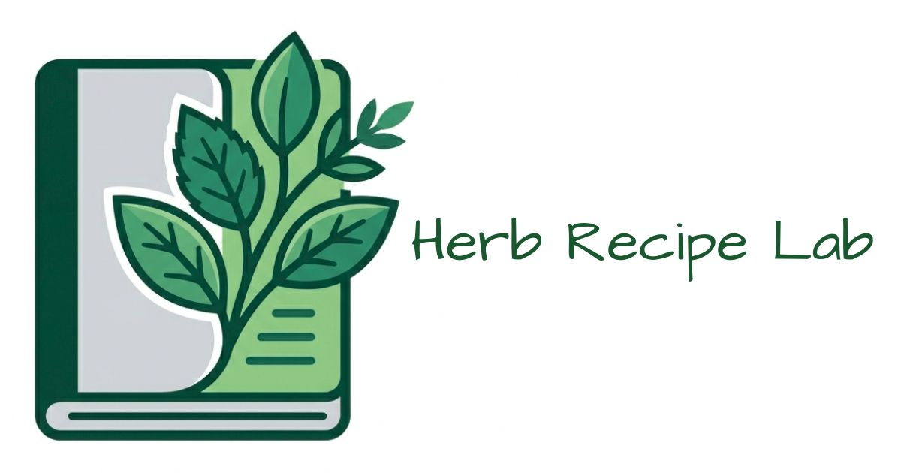
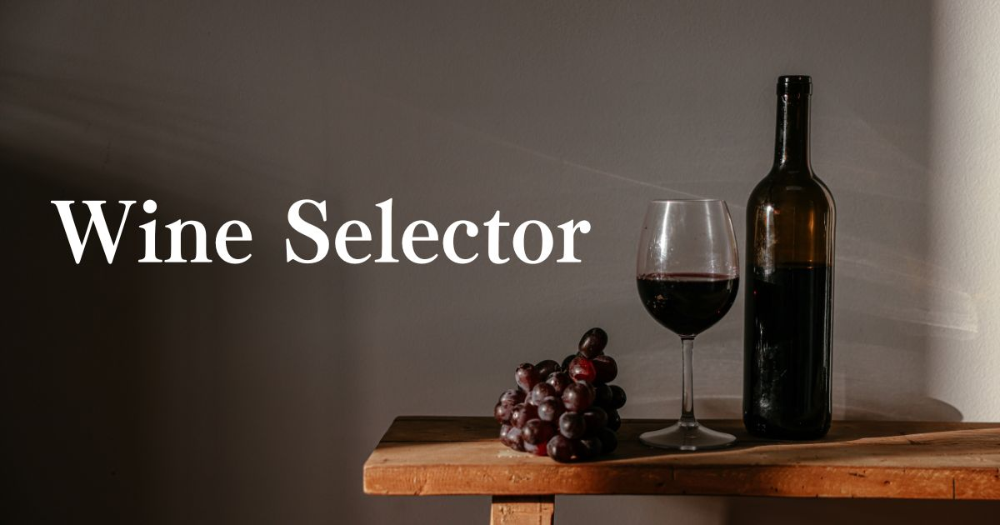

  

  

---

## About Me

- 「好き」を動くプロダクトに。ハーブティー・音楽・生き物 — 日常の興味を Web アプリとして形にしています。
- 農学部卒 → 酒類販売（店舗運営）→ 一般事務（Excel VBA で1日約1時間の業務を削減）を経て、2025年からプログラミングスクール RUNTEQ で Web 開発を学習中
- Ruby on Rails を中心に、設計・実装・テスト・CI・Docker 構築・デプロイまで一貫して個人開発
- 現在、Web エンジニアとして就職活動中
- 🌊 Portfolio: [eluport](https://eluport.onrender.com) — アイコンの魚が棲む「清流の水面・水底」をテーマにしたポートフォリオサイト

---

## Main Project

### 🌿 Herb Recipe Lab

ハーブティーの「配合」から「感想」まで、試行錯誤を再現可能なレシピとして資産化する研究・記録アプリ

**Problem**
美味しかった配合を忘れたり、苦手なブレンドをまた作ってしまったり — ハーブブレンドの試行錯誤は記録に残りにくい。既存のレシピサービスではハーブ特有の「効能」や「配合比」を管理しにくく、手持ちのハーブや苦手な成分から探すこともできない

**Solution**
「配合（STEP 1）」→「飲用後の感想（STEP 2）」の2段階で記録し、"あの一杯" を再現可能なレシピとして蓄積。味の好み・手持ちのハーブ・禁忌の除外を組み合わせたクロス検索と、Gemini API による AI ブレンド提案で「次の一杯」探しを支援

**Highlights**

- 淹れる前と飲んだ後で記録タイミングが異なる実体験に合わせ、配合（`recipes`）と感想（`drinking_logs`）を別テーブルに分けたデータモデル
- 使用ハーブ AND・風味・効能・禁忌除外のクロス検索を共通メソッドに集約し、レシピと市販ハーブティーレビューの両方で再利用
- AI ブレンド提案は Structured Output（JSON Schema）で応答形式を固定し、DB のハーブと照合して実在しないハーブを除外。Gemini が落ちても既存レシピの検索結果は表示される耐障害設計
- テストを整備したうえで Rails 7.2 → 8.0 → 8.1 へ段階的にアップグレード
- GitHub Actions で Brakeman / RuboCop / Minitest / RSpec を自動実行

- 🌐 App: https://herb-recipe-lab.onrender.com （公開レシピ・ハーブ図鑑はログイン不要で閲覧できます）
- 💻 Repo: https://github.com/Elu-72b/Herb_Recipe_Lab

---

## Other Works

| Work                                                                                        | Description                                            | Tech                          | Links                                                                                              |
| ------------------------------------------------------------------------------------------- | ------------------------------------------------------ | ----------------------------- | -------------------------------------------------------------------------------------------------- |
| 🎹 Brew Tune              | 鍵盤クリックで8小節のメロディを作曲・共有できるアプリ  | Rails 8.1 / Hotwire / Tone.js | [App](https://brew-tune.onrender.com) ・ [Repo](https://github.com/Elu-72b/Brew_Tune)              |
| 🍷 Wine Selector  | 3つの質問で好みのワインと料理のペアリングを診断        | Rails 7.0 / Hotwire / MySQL   | [App](https://wine-selector-nowl.onrender.com) ・ [Repo](https://github.com/Elu-72b/wine_selector) |
| 🐟 新種ドジョウ和名ジェネレーター（開発中）                                                 | キーワード2つから新種ドジョウの和名と画像を生成        | Python / FastAPI / Gemini API | [Repo](https://github.com/Elu-72b/Neofish_Generator)                                               |
| 🌊 eluport                                                                                  | 「清流の水面・水底」をテーマにしたポートフォリオサイト | React / TypeScript / Vite     | [Site](https://eluport.onrender.com)                                                               |

---

## Award 🏆

YYYY年MM月度、プログラミングスクール RUNTEQ にて、受講生および運営からの推薦により表彰されました。

---

## Tech Stack

<table align="center">
<tr>
<td width="50%" align="center" valign="top">

### Backend

### Frontend

</td>
<td width="50%" align="center" valign="top">

### Database

### Tool

</td>
</tr>
</table>

---

## Stats

---

  

